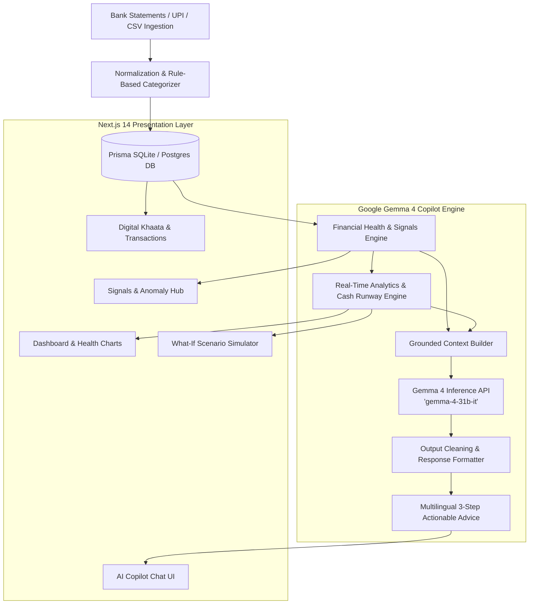

# 🌟 FinHealth AI — SMB Financial Health Platform & AI CFO Copilot

> **Empowering Indian Kiranas & MSMEs with Real-Time Financial Intelligence, Cash Flow Health Scoring, and an Autonomous Multilingual Virtual CFO powered by Google Gemma 4.**

[](https://nextjs.org/)
[](https://www.typescriptlang.org/)
[](https://tailwindcss.com/)
[](https://www.prisma.io/)
[](https://ai.google.dev/gemma)

---

## 📌 Overview

Over 63 million Micro, Small, and Medium Enterprises (MSMEs) in India struggle with cash flow visibility, personal-vs-business fund co-mingling, and lack of affordable financial advisory services. Traditional accounting software only records historical data without offering forward-looking intelligence.

**FinHealth AI** solves this by combining **real-time banking and UPI statement ingestion**, **automated financial health scoring**, **what-if scenario simulation**, and an **Autonomous Virtual CFO Copilot powered by Google Gemma 4 (`gemma-4-31b-it`)**. Store owners get clear, actionable advice in their preferred Indian languages (Telugu, Hindi, Tamil, English, and more) to protect runway, optimize working capital, and make confident business decisions.

---

## ✨ Key Features

### 1. 🤖 Virtual CFO Copilot (Powered by Google Gemma 4)
- **Grounded Financial Context**: The AI assistant receives real-time business telemetry (bank balance, monthly revenue, expense breakdown, cash runway, active alerts, and co-mingled expenses).
- **Concise, Actionable 3-Step Advice**: Delivers direct recommendations with Indian Rupee (₹) calculations tailored to micro-enterprises.
- **8+ Indian Languages & Code-Mixing Support**: Native fluency in English, Telugu, Hindi, Tamil, Kannada, Malayalam, Marathi, and Bengali, including Hinglish and Telugu-English code-mixed queries.
- **Deterministic Offline Fallback Engine**: Guarantees uninterrupted financial assistance even during network disruptions or API rate limits.

### 2. 📊 Comprehensive Financial Health Score (0–100)
- Evaluates liquidity, profitability, cash runway duration, debt burden, and cash flow volatility.
- Categorized status levels: **Green (Healthy)**, **Amber (Caution)**, and **Red (Critical)** with transparent sub-score breakdowns.

### 3. 🚨 Early Warning & Anomaly Signal Engine
- **Co-Mingled Spend Detector**: Isolates personal lifestyle/UPI withdrawals (e.g., Swiggy, Zomato, OTT subscriptions) from business operating accounts.
- **Unusual Supplier Expense Spikes**: Flags abnormal inventory purchases using statistical deviation models.
- **Runway & Margin Compression Warnings**: Proactive alerts before working capital runs dangerously low.

### 4. 🔮 Interactive What-If Scenario Simulator
- Test key business decisions in real-time before committing capital:
  - *Hiring staff / helpers* (calculates impact on monthly net profit and runway).
  - *Taking business or machinery loans* (evaluates EMI stress test).
  - *Opening new branches or expanding retail floor space*.
  - *Supplier raw material cost hikes & seasonal price changes*.

### 5. 💳 Alternative Credit Assessment & Underwriting Dossier
- Generates MSME cash-flow-backed creditworthiness scores.
- Exports a standardized financial health and transaction history report for bank loan officers and NBFC underwriting.

### 6. 📖 Digital Khaata & Ledger
- Track receivables from regular customers and payables to distributors.
- Automated aging analysis and payment reminder recommendations.

### 7. 📥 Multi-Format Statement Ingestion
- Upload PDF/CSV bank statements and UPI transaction logs with automated normalization and categorization.

---

## 🏗️ System Architecture



---

## 🛠️ Tech Stack

| Layer | Technology |
| :--- | :--- |
| **Framework** | [Next.js 14](https://nextjs.org/) (App Router, Server Components & Route Handlers) |
| **Language** | [TypeScript 5.5](https://www.typescriptlang.org/) |
| **Styling & UI** | [Tailwind CSS 3.4](https://tailwindcss.com/), Lucide Icons, Framer Motion |
| **Data Visualization** | [Recharts](https://recharts.org/) |
| **AI / Inference** | [Google Gemma 4](https://ai.google.dev/gemma) (`gemma-4-31b-it`, `gemma-4-26b-a4b-it`) via Google Generative Language API |
| **ORM & Database** | [Prisma ORM 5.19](https://www.prisma.io/) with SQLite / PostgreSQL |
| **Validation** | [Zod 3.23](https://zod.dev/) |

---

## 🚀 Getting Started

### Prerequisites
- **Node.js**: `v18.18.0` or later
- **npm** or **yarn** / **pnpm**
- **Google AI Studio API Key** (for Gemma 4 inference): [Get API Key](https://aistudio.google.com/)

### 1. Clone the Repository
```bash
git clone https://github.com/charan-dss-01/FinHealthAi.git
cd FinHealthAi
```

### 2. Install Dependencies
```bash
npm install
```

### 3. Configure Environment Variables
Create a `.env` file in the root directory:
```bash
cp .env.example .env
```

Add your credentials:
```env
DATABASE_URL="file:./dev.db"
NODE_ENV="development"

# Google AI Studio API Key for Gemma 4
GEMINI_API_KEY="your-google-ai-studio-api-key"

# Gemma Model Selection
GEMMA_MODEL="gemma-4-31b-it"
```

### 4. Initialize Database & Seed Demo Data
```bash
# Push Prisma schema to SQLite database
npm run db:push

# Seed realistic Kirana / MSME sample transactions and business profile
npm run db:seed
```

### 5. Start the Development Server
```bash
npm run dev
```
Open [http://localhost:3000](http://localhost:3000) in your browser.

---

## 🧪 Testing & Verification

Run automated test suites and live AI verification:

```bash
# Test AI Copilot prompt assembly & deterministic rules
npx tsx scripts/test_copilot.ts

# Test Multilingual Gemma 4 response generator
npx tsx scripts/test_multilingual_copilot.ts

# Test Financial signals & anomaly detection
npx tsx scripts/test_signals.ts

# Run Next.js production build verification
npm run build
```

---

## 📂 Project Structure

```
FinHealthAi/
├── prisma/
│   ├── schema.prisma           # Prisma Database schema (Business, Transactions, Signals, Khaata)
│   └── seed.ts                 # Demo dataset seeder for Indian Kirana stores
├── public/                     # Static assets & icons
├── scripts/                    # Verification test scripts & ML dataset utilities
│   ├── test_copilot.ts         # Copilot context builder tests
│   ├── test_multilingual_copilot.ts
│   └── test_signals.ts
├── src/
│   ├── app/                    # Next.js 14 App Router
│   │   ├── api/                # Backend API Routes (Copilot, Auth, Business, Ingest, Simulator)
│   │   ├── copilot/            # AI Virtual CFO Chat Interface
│   │   ├── credit/             # Alternative Credit & Underwriting Dossier
│   │   ├── dashboard/          # Financial Health Dashboard & Metric Cards
│   │   ├── khaata/             # Digital Ledger & Customer Receivables
│   │   ├── landing/            # Public Product Showcase Landing Page
│   │   ├── signals/            # Anomaly & Co-mingling Alert Center
│   │   ├── simulator/          # What-If Cash Runway Simulator
│   │   ├── transactions/       # Transaction Explorer & Categorization
│   │   └── upload/             # Bank & UPI Statement Ingestion
│   ├── components/             # Reusable UI & Layout Components
│   │   ├── Navigation.tsx      # Responsive Header & Role Navigation
│   │   ├── LanguageSelector.tsx# 8-Language Switcher
│   │   └── ui/                 # Metric cards, Badges, Buttons, Insight cards
│   ├── lib/
│   │   ├── ai/
│   │   │   └── copilot.ts      # Gemma 4 LLM Integration, Prompt Grounding, Output Cleaning
│   │   ├── analytics/          # Health scoring, Signals, Simulator & Forecaster engines
│   │   ├── i18n/               # Multilingual context & translation dictionaries
│   │   └── ingestion/          # Statement parser & co-mingling analyzer
│   └── types/                  # TypeScript interfaces & domain models
├── .env.example                # Template for environment configuration
├── .gitignore                  # Git ignore rules
├── package.json
├── tailwind.config.ts
└── tsconfig.json
```

---

## 🌐 Multilingual Capabilities

FinHealth AI breaks language barriers for grassroots business owners across India:

| Language | Code | AI Support |
| :--- | :--- | :--- |
| **English** | `en` | Full Financial Advisory & Explanations |
| **తెలుగు (Telugu)** | `te` | Native Script & Romanized Code-Mixed Queries |
| **हिन्दी (Hindi)** | `hi` | Shuddh Hindi & Hinglish Business Context |
| **தமிழ் (Tamil)** | `ta` | Native Script Financial Guidance |
| **ಕನ್ನಡ (Kannada)** | `kn` | Native Script Financial Guidance |
| **മലയാളം (Malayalam)** | `ml` | Native Script Financial Guidance |
| **मराठी (Marathi)** | `mr` | Native Script Financial Guidance |
| **বাংলা (Bengali)** | `bn` | Native Script Financial Guidance |

---

## 🔒 Security & Privacy

- **No Hardcoded Keys**: All API secrets and database URLs are loaded strictly via environment variables.
- **Data Privacy**: Grounded business context passed to Gemma 4 contains sanitized financial metrics without raw PII (Aadhaar/PAN numbers).
- **Deterministic Safeguards**: Built-in validation prevents hallucinations or unsafe financial recommendations.

---

## 📄 License

This project is licensed under the **MIT License**.
